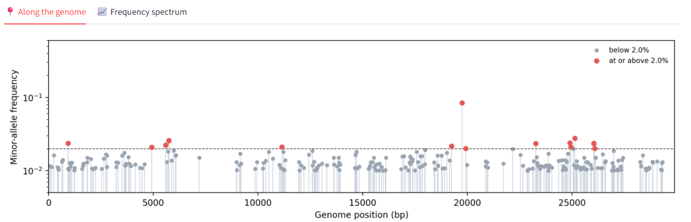
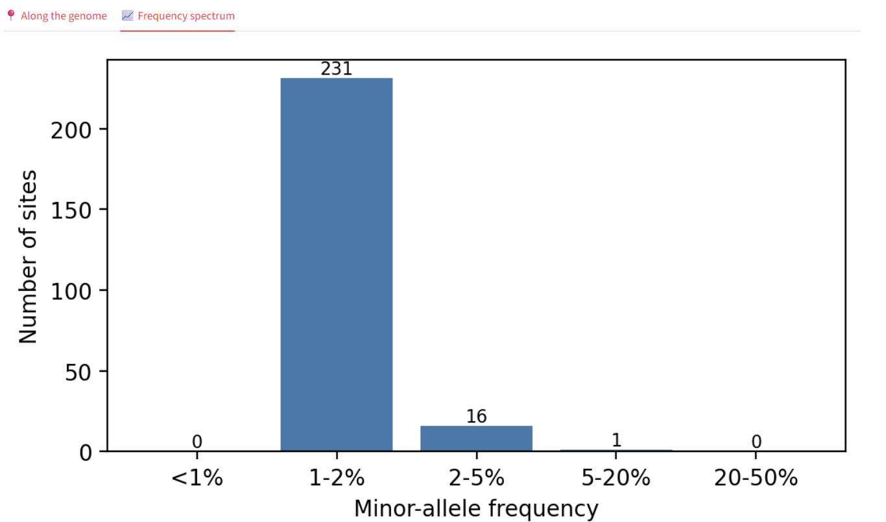

# 🧬 Quasispecies Explorer

A pipeline and interactive dashboard for quantifying and visualising intra-host viral quasispecies from raw FASTQ reads.

It goes beyond a consensus sequence: it maps reads, calls low-frequency variants, reconstructs linked haplotypes with CliqueSNV, and reports diversity metrics and a variation graph, with the **frequency of every haplotype kept all the way through**.

## 📸 Screenshots



## What changed in v2, and why

| Before | Now |
|---|---|
| If CliqueSNV found no linked haplotypes, the pipeline generated `--num_haps` haplotypes by mutating each site independently. Haplotype count and rare-haplotype load then depended on `--num_haps`, not on the sample. | **No haplotypes are invented.** The filtered iVar variants are written for site-level analysis. A synthetic cloud is available only with `--simulate-cloud N`, and its headers carry `synthetic=true`; the dashboard then hides haplotype-level metrics and says why. |
| CliqueSNV haplotype frequencies were dropped (records renamed `hap_N`); the app weighted every record equally. | Frequencies are kept in the headers (`>hap_1 freq=0.70`) and used by every metric. FASTA without frequencies is still accepted, and the app says the records are weighted equally. |
| A hard-coded filter set a site's entropy to 0 when its second allele was under 5%. | The filter is an explicit slider, default **off**, and it uses the combined frequency of all minor alleles. |
| "Variation graph" was one vertical tick per hotspot. | A real graph: shared blocks and variant bubbles, every haplotype a path, widths proportional to frequency. Export as **GFA**. |
| Every command ran through `shell=True` with fixed file names in the current directory (stale files could be reused). | Argument lists, no shell; a fresh per-run work directory; the run is recorded in `<out>.run_info.json`. |
| ARTIC SARS-CoV-2 primers always downloaded. | Trimming is optional: `--primers FILE`, or `--artic-v3` for SARS-CoV-2. |
| CliqueSNV can fail and still exit normally (it prints a stack trace, writes a placeholder haplotype with frequency 1.0 and records `Runtime error` only in its JSON), so a failed run looked like a one-haplotype result. | The JSON is read; any error means the placeholder is **not used**, the reason is printed and stored in `run_info.json`, and CliqueSNV runs with `-log`. |
| Only haplotype FASTA could be explored. | **Site-level mode**: upload the iVar variants table (`.tsv`) to see per-site minor-allele frequencies, the frequency spectrum and a π estimate when linked haplotypes are not available. |
| No tests. | 158 tests. |

## Pipeline

1. **Map** paired reads with `minimap2`.
2. **Trim** primers with `ivar trim` (only if `--primers` or `--artic-v3` is given).
3. **Call** site-level variants with `ivar variants` (down to 1%).
4. **Reconstruct** linked haplotypes with `CliqueSNV` (`-tf`, default 0.001). Their frequencies are kept.
5. **Explore** in the Streamlit dashboard.

## Installation

```bash
conda env create -f environment.yml
conda activate quasispecies
```

## Usage

```bash
python fastq_to_fasta.py \
  --fastq1 raw_reads/SRR12447392_1.fastq \
  --fastq2 raw_reads/SRR12447392_2.fastq \
  --ref MN908947.3.fasta \
  --artic-v3 \
  --out real_haplotypes.fasta

streamlit run app.py        # upload real_haplotypes.fasta
```

Outputs, next to `--out`: the haplotype FASTA (only if CliqueSNV found linked haplotypes), `<out>.variants.tsv` (site-level variants, written when it did not), and `<out>.run_info.json` (settings, seed, and whether haplotypes came from `cliquesnv`, `synthetic` or `none`).

### Site-level view (no haplotypes needed)

Upload `<out>.variants.tsv` (or any `ivar variants` table) in the dashboard. You get the number of variable sites at a minor-allele-frequency threshold you choose (default 2%), fixed differences from the reference listed separately, the frequency spectrum, a π estimate, and a table of the most variable sites. Read depth is filtered (default 100x) because a high frequency at a shallow site is unreliable. Variants close to iVar's 1% calling threshold are partly sequencing noise, so report them with care.

Definitions per position: the minor-allele frequency is 1 minus the frequency of the most common allele, and a position whose most common allele is not the reference base is a *fixed difference* (lineage-defining), not diversity. This view cannot show linkage between sites.

### Linkage check (are nearby minor variants on the same genome?)

Per-site frequencies cannot show whether two variants sit on the same viral genome. Reads can: if the alternative alleles of two sites appear together on the same read fragment far more often than chance, they are physically linked, i.e. one minor haplotype carries both.

```bash
# group nearby polymorphic sites automatically
python linkage_check.py --alignment real_haplotypes_work/trimmed.sam \
                        --variants real_haplotypes.variants.tsv --auto

# or test specific sites (alleles come from the variants table; override with POS:ALT)
python linkage_check.py --alignment trimmed.sam --variants variants.tsv \
                        --sites 5743,5744 --sites 26042,26044,26046
```

The alignment can be a `.sam`, or a `.bam` read through `samtools`. For every read fragment the script records which allele it shows at each site (CIGAR-aware; the two mates of a pair are merged; bases below Q20 are ignored; secondary, supplementary, unmapped and QC-failed reads are skipped), counts the allele combinations (`A` = alt, `R` = ref, `O` = other, `-` = not covered), and for each pair of sites reports the counts, the conditional probabilities, a Fisher exact p-value and a plain-language verdict: LINKED, NESTED, MUTUALLY EXCLUSIVE, consistent with independence, or too rare to tell. Results are printed and written to `<out>.pairs.tsv`, `<out>.patterns.tsv` and `<out>.alt_fragments.tsv`. The last lists the reads behind every alt-carrying fragment (flag, position, mapping quality, CIGAR), and the printed report compares alt-carrying with reference-only fragments: distinct fragment extents, how many have both mates over the sites, and strand balance. Use it to tell a real minor haplotype from an artifact, and to check whether a read-level frequency (iVar counts reads) is inflated relative to the fragment-level one.

Limits: only sites within one read pair's span (a few hundred bp) can be compared. Co-occurrence on a fragment is evidence of linkage, not proof: a shared mapping or PCR artifact can mimic it, so also check strand balance and amplicon boundaries. The verdict thresholds are heuristics.

### Comparing samples, and an artifact check

Run the pipeline on each sample (`--skip-cliquesnv` gives the site-level variants only, which is all this needs and avoids CliqueSNV's memory use), then:

```bash
python compare_samples.py --variants samples/*.variants.tsv --metadata study_runs.tsv --out compare
```

The table lists variable sites and the π estimate per sample, **twice**: with all minor variants, and without G>T / C>A changes. Those two changes are a recognised artifact class of sequencing and library preparation (oxidative damage), and real within-host SARS-CoV-2 variation is usually dominated by other changes such as C>T. On the 8 Illumina samples of SRR12447392's study, 50–99% of the minor variants of most samples were G>T/C>A, and the most "diverse" sample (153 variable sites) fell to 1 site without them. Nothing is removed silently, and the class is an indicator, not proof: a real G>T mutation is not excluded, it is just not counted in the second column. Compare only samples from the same platform and protocol.

### Gene and amino-acid effect of each variant

```bash
python annotate_sites.py --variants samples/*.variants.tsv --gff MN908947.3.gff3 --ref MN908947.3.fasta --out annotated
```

Labels every variant (frequency >= 2%, depth >= 100) with its gene, codon and amino-acid change (e.g. `S:D614G`) and its effect: synonymous, missense, stop gained/lost, or noncoding. Handles multi-segment CDS (SARS-CoV-2 orf1ab is read through a -1 ribosomal frameshift, so the shared base has two codon contexts) and minus-strand genes. A per-gene table counts the minor variants, also without G>T / C>A. The reference FASTA must be the one the reads were mapped to: a base mismatch stops the run. The coordinate handling was checked against published sites (S D614G, orf1ab P4715L, ORF3a Q57H). Counts are numbers of variants, not rates per available site, so they are not dN/dS; orf1ab codons count along the whole polyprotein, not nsp numbering. Only the CDS features of the GFF3 are used.

Linked variants (from `linkage_check.py`) can be annotated **as one haplotype** with `annotate_haplotype.py --variants X.variants.tsv --gff MN908947.3.gff3 --ref MN908947.3.fasta --sites 26042,26044,26046`: changes in the same codon are applied together, and the joint amino-acid change is shown next to what each change would do alone (flagged *emergent* when the combination gives an amino acid no single change gives). It assumes the variants really are on one genome and does not check that.

### Do the reads behind a linked cluster look like normal reads? (`read_check.py`)

```bash
python read_check.py --alignment SRR12447392_work/trimmed.sam --variants SRR12447392.variants.tsv \
    --ref MN908947.3.fasta --sites 26042,26044,26046 --sites 5743,5744 --out readcheck
```

Linked minor variants can be real, or they can be reads from another source that map badly. Such reads usually carry extra mismatches elsewhere and more soft-clipping. For each group, reads that show the alternative allele at every site they cover (*alt*) are compared with reads showing the reference allele (*ref*) over the same sites: unexplained mismatches (outside the group sites and the fixed differences), soft-clipped bases, mapping quality, indels and strand. Flags are raised for at least one extra mismatch per read, a 25-point higher share of reads with 10+ soft-clipped bases, or 10 points lower mapping quality (heuristic thresholds). The alt reads are also written as FASTA (in the reference's orientation) for NCBI BLAST. A clean result does not rule out a PCR or library artifact, and with a handful of alt reads the comparison is descriptive.

The command line summary also works without the dashboard:

```bash
python -m quasigraph --fasta real_haplotypes.fasta --out results
```

### Input format

Aligned haplotypes in FASTA. A frequency in the header is read from either `_fr_0.58` (CliqueSNV default) or `freq=0.58`. Frequencies are renormalised to sum to 1 over the haplotypes reported. All sequences must have the same length; `-` counts as a difference.

## Metrics

| Metric | Definition |
|---|---|
| Distinct haplotypes | unique sequences after merging duplicates |
| Effective haplotypes | 2^H, where H is the Shannon entropy of the haplotype frequencies |
| Nucleotide diversity (π) | frequency-weighted expected differences between two random genomes, per site (equals the mean over sites of 1 − Σp²) |
| Site entropy | Shannon entropy (bits) of the allele distribution at each column |
| Rare haplotype load | total frequency carried by haplotypes below the threshold (default 5%). The count-based reading (fraction of distinct haplotypes below it) is also reported |

Note that CliqueSNV omits haplotypes below `-tf`, so rare haplotype load can only describe haplotypes above that cutoff.

## Tests

```bash
python -m pytest
```

## Status and limits

- The pure-Python parts (metrics, graph, GFA, FASTA and iVar/CliqueSNV parsing, synthetic cloud) are covered by tests.
- The pipeline (minimap2, ivar, linkage check, comparison, annotation) has been run on 8 real SARS-CoV-2 Illumina samples from one public study (SRR12447392 and seven others from the same BioProject, Maryland/DC, March 2020). The test suite itself uses synthetic data and small real tables, not the raw reads.
- CliqueSNV ran out of Java memory on every attempt on the author's 5 GB machine (`OutOfMemoryError`, also with `-tf 0.05 -t 20 -cm fast`), so no haplotypes were reconstructed from real reads; the haplotype-level views (FASTA mode, graph) have only been used with simulated or example haplotypes. The site-level, linkage, comparison and annotation steps do not need CliqueSNV (`--skip-cliquesnv`).
- The dashboard's FASTA mode has been run under Streamlit by the author. The site-level mode's analysis and figures are tested (including on a real variants table), but its page layout has not yet been run under Streamlit.
- If CliqueSNV fails on a real sample (it exits normally and records the error in its JSON; the pipeline detects this), run it by hand with `-log` on the `.sam` in the work directory to see the exception (try a higher `-tf`, e.g. 0.01 or the default 0.05, and a larger Java heap if memory is the cause).
- The comparison module is covered by tests (including boundary and mutation checks); the artifact interpretation rests on the substitution spectrum alone, not on a separate error model.
- The linkage check was tested on synthetic reads with known structure (including CIGAR edge cases, mate merging and mutation tests of the code) and on a simulation built from a real variants table. The `.bam` route through `samtools` has not been run here; use the `.sam` in the work directory if it gives trouble.
- The graph is built from an existing alignment; it does not reconstruct haplotypes from reads and it does not align indels.
- Metadata is matched per `HaplotypeID`. Temperature and host are usually properties of a sample, so for real work compare metrics **across samples**.

## License

MIT.
